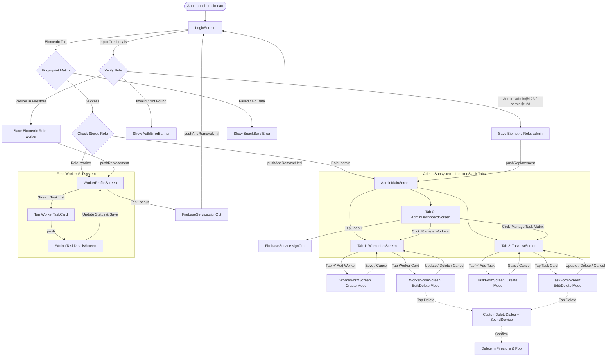

# Egy Tech Mobile App — Directory Distribution & Application Routing Architecture
**Pearson BTEC Higher National in Computing — Unit 7: Assignment 2**  
*Project Name:* `egy_tech_mobile_app` (Elsewedy Electric Field Workforce & Task Management System)  
*Document Version:* 1.0.0  
*Target Environment:* Flutter (Android / iOS / Desktop / Web)

---

## 1. Executive Project Overview

The **Egy Tech Mobile App** is an industrial workforce and task dispatch management application engineered for **Elsewedy Electric**. It provides a role-based, real-time ecosystem connecting administrative supervisors with field workers and technicians.

### Core Architectural Pillars
- **Framework & SDK:** Flutter (Dart SDK `^3.13.3`)
- **Backend Infrastructure:** Firebase Core, Cloud Firestore (NoSQL Realtime Database), Firebase Auth
- **Hardware Integration:** Native Biometric Authentication (`local_auth` fingerprint scanning)
- **Local Persistence:** `shared_preferences` for credential caching and session state
- **Audio Feedback:** `audioplayers` for interactive tactile and auditory cues on deletions
- **Architectural Pattern:** **Feature-First + Clean Layered Core** (separating reusable foundation utilities from feature-specific widgets and top-level routing screens).

---

## 2. Directory Tree & Project Arrangement

```
Mobile App/
├── Assets/                                  # Static media assets & brand identity
│   ├── app_logo.png                         # Launcher & brand splash emblem
│   ├── logo.png                             # Elsewedy corporate header logo
│   └── sounds/                              # Audio assets
│       └── trash_sound.mp3                  # Deletion confirmation sound effect
│
├── android/                                 # Android native host project & Gradle config
├── ios/                                     # iOS native host project & CocoaPods
├── web/                                     # Web build support files
├── windows/                                 # Windows desktop host runner
│
├── lib/                                     # Main Dart application source code
│   ├── main.dart                            # App entrypoint, theme injection & initial route
│   ├── firebase_options.dart                # Firebase platform auto-configuration
│   │
│   ├── core/                                # System-wide shared foundations
│   │   ├── constants/                       # Central design system tokens & string values
│   │   │   └── app_constants.dart           # AppColors, AppStrings, AppAssets
│   │   ├── models/                          # Pure business entities & data transfer objects
│   │   │   └── models.dart                  # Worker model, TaskItem model
│   │   ├── services/                        # System infrastructure & device hardware bridges
│   │   │   ├── biometric_service.dart       # Fingerprint authentication & local credential storage
│   │   │   ├── firebase_service.dart        # Firestore CRUD operations, queries & live streams
│   │   │   └── sound_service.dart           # Audio playback controller for tactile feedback
│   │   ├── theme/                           # Global typography, elevations, input decorations
│   │   │   └── app_theme.dart               # AppTheme.lightTheme definition
│   │   └── widgets/                         # Reusable core visual components
│   │       ├── custom_delete_dialog.dart    # Standardized deletion confirmation modal
│   │       ├── custom_header_bar.dart       # Standardized back-navigable top bar
│   │       └── user_profile_header.dart     # User badge, initials avatar & logout trigger
│   │
│   ├── features/                            # Feature-specific modular UI components
│   │   ├── admin/widgets/                   # Admin portal specific widgets
│   │   │   ├── metric_card.dart             # KPI summary tile (Workers, Tasks, Completed)
│   │   │   ├── operation_card.dart          # Quick navigation launcher card
│   │   │   ├── task_card.dart               # Admin task matrix preview card
│   │   │   └── worker_card.dart             # Admin worker directory preview card
│   │   ├── auth/widgets/                    # Authentication feature components
│   │   │   ├── auth_error_banner.dart       # Dynamic red-themed validation error alert
│   │   │   ├── custom_text_field.dart       # Rounded input field with label and icons
│   │   │   └── sign_in_button.dart          # Primary branded gradient submit button
│   │   └── worker/widgets/                  # Worker portal specific widgets
│   │       └── worker_task_card.dart        # Field operative task card with status chips
│   │
│   └── screens/                             # Top-level routable pages & coordinators
│       ├── login_screen.dart                # Role-based login gateway & biometric trigger
│       ├── admin_main_screen.dart           # BottomNavigationBar wrapper (IndexedStack coordinator)
│       ├── admin_dashboard_screen.dart      # Admin Tab 0: KPI Metrics & quick actions
│       ├── worker_list_screen.dart          # Admin Tab 1: Searchable worker directory & CRUD
│       ├── worker_form_screen.dart          # Create/Edit worker profile modal screen
│       ├── task_list_screen.dart            # Admin Tab 2: Searchable task matrix & CRUD
│       ├── task_form_screen.dart            # Create/Edit industrial task assignment screen
│       ├── worker_profile_screen.dart       # Worker root screen: assigned tasks feed
│       └── worker_task_details_screen.dart  # Worker task detail inspector & status changer
│
├── pubspec.yaml                             # Package dependencies, environment & assets registration
└── README.md                                # General repository guidance
```

---

## 3. Deep Breakdown of Directories & Responsibilities

### 3.1 `lib/main.dart`
- **Role:** Application Bootstrap & Entrypoint.
- **Responsibilities:**
  - Invokes `WidgetsFlutterBinding.ensureInitialized()`.
  - Initializes Firebase (`Firebase.initializeApp`) using platform-specific credentials.
  - Configures Edge-to-Edge System UI Overlay (`SystemUiOverlayStyle`) matching Elsewedy brand aesthetics.
  - Instantiates `MaterialApp` with `AppTheme.lightTheme` and designates `LoginScreen` as the `home` root.

### 3.2 `lib/core/` (Foundation Layer)
| Directory / File | Type | Purpose & Details |
| :--- | :--- | :--- |
| **`constants/app_constants.dart`** | Constant Registry | Defines `AppColors` (Primary Red `#C8102E`, dark tones, status chip backgrounds), `AppStrings` (UI labels, placeholders, errors), and `AppAssets` paths. |
| **`models/models.dart`** | Domain Models | Pure Dart data classes: `Worker` (ID, fullName, username, password, phone, initials) and `TaskItem` (ID, title, description, assignedWorker, date, priority, status). Includes `toMap()` and `fromMap()` serializers. |
| **`services/firebase_service.dart`** | Data Access Layer | Encapsulates Cloud Firestore operations (`workers` and `tasks` collections). Handles custom authentication routing, real-time KPI streams (`getDashboardMetricsStream`), task status mutation, and worker lifecycle. |
| **`services/biometric_service.dart`** | Hardware & Security | Interfaces with `local_auth` to execute biometric prompts. Leverages `shared_preferences` to safely record and recall the last authenticated user, role, and worker credentials. |
| **`services/sound_service.dart`** | Multimedia Utility | Manages low-latency audio playback for interactive auditory cues (e.g. playing `trash_sound.mp3` when entities are deleted). |
| **`theme/app_theme.dart`** | Design System | Configures global `ThemeData`, font families, input decoration styling, card elevations, button shapes, and color schemes. |
| **`widgets/`** | Core UI Components | Contains reusable dialogs (`CustomDeleteDialog`), navigation headers (`CustomHeaderBar`), and header profile avatars (`UserProfileHeader`). |

### 3.3 `lib/features/` (Modular Component Layer)
- **`features/admin/widgets/`**: Contains the visual widgets supporting the admin experience:
  - `metric_card.dart`: Visual container displaying real-time counts with color-coded status badges.
  - `operation_card.dart`: Interactive action tiles on the dashboard that switch tabs or open forms.
  - `worker_card.dart` & `task_card.dart`: List items with action buttons, status pills, and edit handlers.
- **`features/auth/widgets/`**:
  - `custom_text_field.dart`: Form fields with border highlighting, visibility toggles, and icon slots.
  - `sign_in_button.dart`: Elevation-styled primary call-to-action button.
  - `auth_error_banner.dart`: Animated alert banner rendered when credentials fail.
- **`features/worker/widgets/`**:
  - `worker_task_card.dart`: Streamlined card tailored for field operatives showing priority badges, due dates, and current progress status.

### 3.4 `lib/screens/` (Presentation & Routing Layer)
- Contains all full-page widgets rendered by the Flutter Navigator. Each screen coordinates user actions, calls services, and transitions to subsequent views.

---

## 4. Application Routing Architecture

### 4.1 Routing Strategy
The application employs Flutter's **Imperative Navigator Stack Architecture** with dedicated role-based route switching:
1. **Replacement Transitions (`pushReplacement`)**: Used at login to discard the authentication screen from memory.
2. **Stack Clearing (`pushAndRemoveUntil`)**: Executed on logout to completely clear back-stack history, preventing unauthorized back-navigation.
3. **Tabbed Coordination (`IndexedStack`)**: Utilized in `AdminMainScreen` to preserve scroll positions and state across the Dashboard, Worker Directory, and Task Matrix tabs.
4. **Push & Pop (`push` / `pop`)**: Used for drill-down master-detail flows (e.g., viewing task details or opening creation/editing forms).

---

### 4.2 Comprehensive Navigation Flow Diagram



---

## 5. Screen Navigation & Routing Matrix

The following table provides the exhaustive routing specification for every screen in the project:

| Screen Name | Path / File | Access Role | Navigation Method | Parameters / Props | Exit / Pop Action |
| :--- | :--- | :--- | :--- | :--- | :--- |
| **`LoginScreen`** | `lib/screens/login_screen.dart` | Public | Initial Route (`home: const LoginScreen()`) | None | Terminates session; exits app |
| **`AdminMainScreen`** | `lib/screens/admin_main_screen.dart` | Administrator | `Navigator.pushReplacement` | `initialIndex` (default: 0) | Logs out via `pushAndRemoveUntil(LoginScreen)` |
| **`AdminDashboardScreen`** | `lib/screens/admin_dashboard_screen.dart` | Administrator | Embedded in `AdminMainScreen` (Tab index 0) | `onNavigateToWorkers`, `onNavigateToTasks`, `onLogout` | Handled by parent `IndexedStack` |
| **`WorkerListScreen`** | `lib/screens/worker_list_screen.dart` | Administrator | Embedded in `AdminMainScreen` (Tab index 1) or pushed directly | `showBackButton: bool` | Switches tab or pops back |
| **`WorkerFormScreen`** | `lib/screens/worker_form_screen.dart` | Administrator | `Navigator.push` | `worker: Worker?` *(null for Add, populated for Edit)* | `Navigator.pop()` after create/update/delete |
| **`TaskListScreen`** | `lib/screens/task_list_screen.dart` | Administrator | Embedded in `AdminMainScreen` (Tab index 2) or pushed directly | `showBackButton: bool` | Switches tab or pops back |
| **`TaskFormScreen`** | `lib/screens/task_form_screen.dart` | Administrator | `Navigator.push` | `task: TaskItem?` *(null for Add, populated for Edit)* | `Navigator.pop()` after create/update/delete |
| **`WorkerProfileScreen`** | `lib/screens/worker_profile_screen.dart` | Field Worker | `Navigator.pushReplacement` | `workerName: String` | Logs out via `pushAndRemoveUntil(LoginScreen)` |
| **`WorkerTaskDetailsScreen`** | `lib/screens/worker_task_details_screen.dart` | Field Worker | `Navigator.push` | `task: TaskItem` | `Navigator.pop()` after saving status update |

---

## 6. Authentication & Role-Based Routing Logic

### 6.1 Credential Login Workflow (`_handleSignIn`)
```
                  [User Enters Username & Password]
                                  │
                                  ▼
                 Is username == 'admin@123' &&
                    password == 'admin@123'?
                                 / \
                                /   \
                             YES     NO
                             /         \
                            /           ▼
           Role: 'admin'       Query Firestore 'workers' collection
                  │            where username == input
                  │                     / \
                  │                    /   \
                  │                 MATCH  NO MATCH
                  │                  /       \
                  │        Role: 'worker'     Show AuthErrorBanner
                  │                  │
                  ▼                  ▼
     [Save to SharedPreferences via BiometricService.saveSuccessfulLogin()]
                  │                  │
                  ▼                  ▼
       Route to AdminMainScreen     Route to WorkerProfileScreen
```

### 6.2 Biometric Fast-Track Workflow (`_handleBiometricLogin`)
1. Checks `BiometricService.hasSavedLogin()`:
   - If `false`, display floating SnackBar requiring standard credential login first.
2. Triggers device biometric hardware prompt (`BiometricService.authenticateWithFingerprint()`).
3. If successful:
   - Inspects `BiometricService.getLastLoginRole()`.
   - If role is `'admin'` -> navigates immediately to `AdminMainScreen`.
   - If role is `'worker'` -> queries cached `lastWorkerName` and navigates to `WorkerProfileScreen(workerName: name)`.

---

## 7. Project Arrangement Best Practices & Scaling Plan

For enterprise maintenance and upcoming Pearson assessment criteria, the following architectural evolutions are recommended:

### 7.1 Transition to Declarative Named Routing (`go_router`)
While the current imperative `Navigator` implementation satisfies all assignment specifications, adopting `go_router` offers several architectural advantages:
- **Centralized Route Registry:** Eliminates hardcoded `MaterialPageRoute` builders scattered across screens.
- **Deep Linking:** Enables direct navigation to specific task or worker IDs via URL paths (e.g. `/admin/tasks/:id`).
- **Guarded Redirects:** Implements route guards directly at the configuration level rather than inside button handlers.

#### Proposed `go_router` Route Schema:
```dart
final goRouter = GoRouter(
  initialLocation: '/login',
  routes: [
    GoRoute(
      path: '/login',
      builder: (context, state) => const LoginScreen(),
    ),
    GoRoute(
      path: '/admin',
      builder: (context, state) => const AdminMainScreen(),
      routes: [
        GoRoute(
          path: 'worker-form',
          builder: (context, state) => WorkerFormScreen(worker: state.extra as Worker?),
        ),
        GoRoute(
          path: 'task-form',
          builder: (context, state) => TaskFormScreen(task: state.extra as TaskItem?),
        ),
      ],
    ),
    GoRoute(
      path: '/worker',
      builder: (context, state) => WorkerProfileScreen(workerName: state.extra as String),
      routes: [
        GoRoute(
          path: 'task-details',
          builder: (context, state) => WorkerTaskDetailsScreen(task: state.extra as TaskItem),
        ),
      ],
    ),
  ],
);
```

### 7.2 Directory Distribution Governance Checklist
- [x] **Core Independence:** Files in `lib/core/` must never import files from `lib/screens/` or `lib/features/`.
- [x] **Feature Encapsulation:** Widgets inside `lib/features/` should only reference their associated domain or `lib/core/`.
- [x] **Screen Orchestration:** Screens inside `lib/screens/` serve purely as coordinators assembling features, managing state streams, and invoking navigation.
- [x] **Zero Direct Database Calls in Presentation:** Presentation widgets must delegate all Firestore operations directly to `FirebaseService`.

---
*Generated for Mohamed Maher — Pearson Grade 3 Computing — Elsewedy Electric Egy Tech Platform.*
